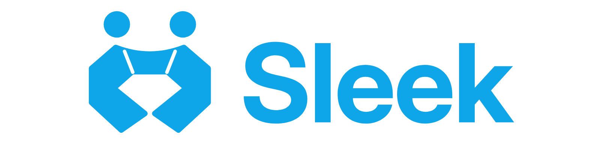

# Brand — Sleek by Me AI

## Logo
The mark shows two people reaching into a handshake. Together they form a shield, which stands for trust between customer and artisan, with Sleek protecting both. It was redrawn from the original artwork as a clean, symmetric vector on a 120-unit grid: rounded joins, pointed feet, and the "‹ ›" cut-outs that make the arms. The wordmark is Inter Display Bold, converted to outlines, with tracking at −1.5%.

| File | Use |
| --- | --- |
| `assets/brand/sleek-logo.svg` / `.png` | Primary, sky on light |
| `assets/brand/sleek-logo-two-tone.svg` | Sky mark + deep-blue wordmark (used in app, light theme) |
| `assets/brand/sleek-logo-dark.svg`, `sleek-logo-on-dark.png` | Dark backgrounds |
| `assets/brand/sleek-logo-white.svg`, `sleek-logo-on-deep.png` | On sky, deep blue or photos |
| `assets/brand/sleek-mark.svg`, `sleek-mark-white.svg` | Icon-only uses |
| `assets/brand/sleek-wordmark.svg` | Wordmark only |
| `src/components/Logo.tsx` | `<Logo />` and `<LogoMark />` in the app (react-native-svg) |

Clear space: at least the head diameter on every side. Minimum size: 20px for the mark, 80px wide for the full logo.

## Colour
| Token | Hex |
| --- | --- |
| Sky (primary) | `#0EA5E9` |
| Deep blue | `#0B3D91` |
| White | `#FFFFFF` |
| Dark background | `#050B18` |

## Voice
Plain, short, reassuring. Say what happens to the user's money and data. Avoid jargon. For example, write "Your money stays in escrow until you approve the work", not "Funds are subject to escrow terms".
